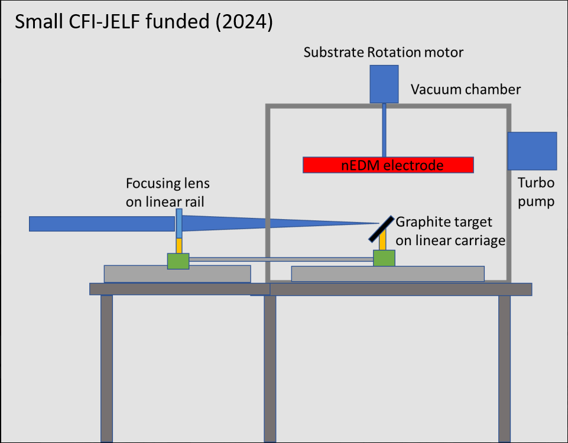
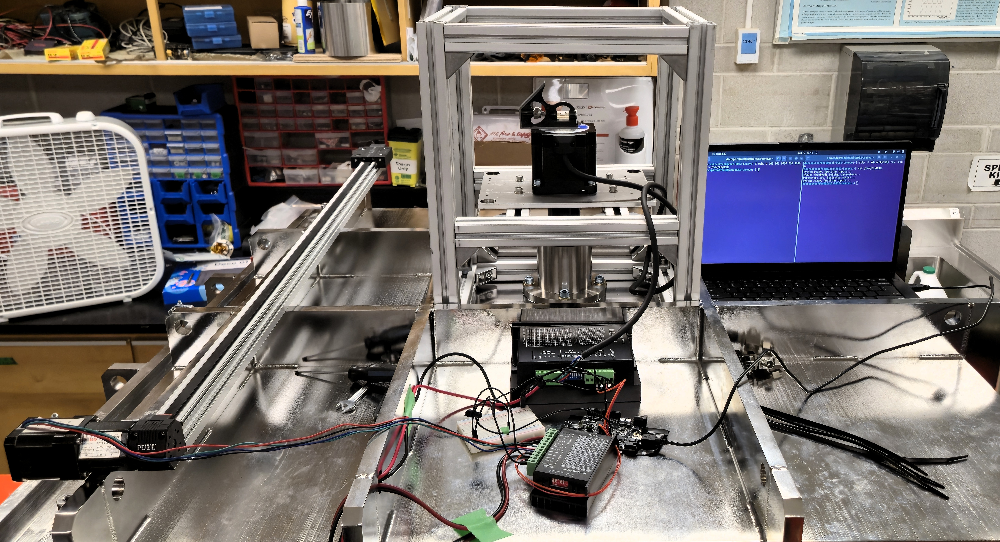
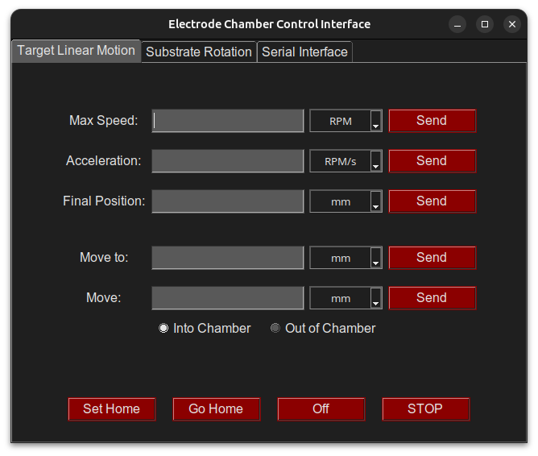
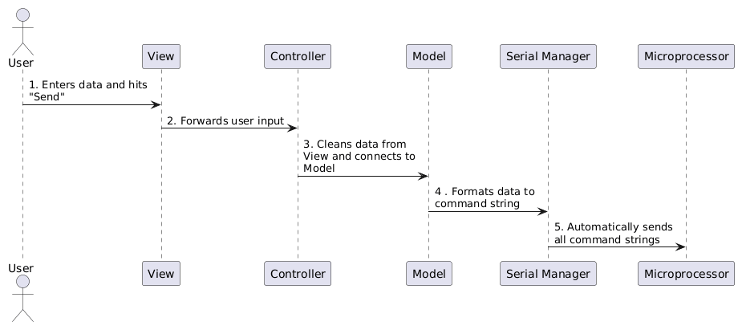
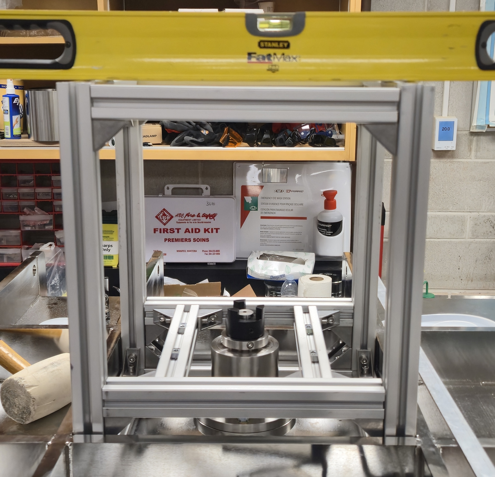

# Electrode Coating Chamber — Dual-Axis Stepper Control System

Embedded motion-control hardware, Arduino firmware, and a Python desktop GUI built for **Dr. Russell Mammei’s Guide Coating Facility** at The University of Winnipeg (NSERC USRA, Summer 2026). This apparatus supports the **TRIUMF Ultracold Advanced Neutron (TUCAN)** collaboration’s neutron electric dipole moment (nEDM) experiment, where disc-shaped electrodes are coated in diamond-like carbon (DLC) inside a vacuum chamber.

To achieve an even coating across the disc, the system coordinates two independent stepper axes at the same time: a rotational motor (`S1`) spins the electrode substrate at a constant angular velocity through a rotary vacuum feedthrough, while a linear rail (`S2`) accelerates the focusing lens and linked graphite sputtering target back and forth along the substrate’s radius to keep the laser in focus.

> **Status:** A functional alpha prototype is currently in use in the lab. Core mechanical, electrical, firmware, and GUI subsystems meet technical requirements; ongoing refinement has been handed off to a Ph.D. student.

**Demo videos of the working system can be found in this [YouTube playlist](https://youtube.com/playlist?list=PLAvhgnVTocMs3Cq6__9881hpgHXAFMh3O).**

\
*Chamber schematic (Dr. Russell Mammei, The University of Winnipeg).*

\
*Preview of the hardware.*

\
*Preview of the GUI.*

---

## System Architecture

The desktop control application uses a **Model–View–Controller (MVC)** design paired with a background serial worker thread so the UI stays responsive while talking to the microcontroller.



### Software (`gui/`)

The GUI is written in Python (`tkinter`) and split into three decoupled parts for maintainability: the View (`view.py`, `widgets.py`) only handles what is shown on screen, the Model (`model.py`) holds motor state, clamps inputs to safe per-motor bounds, and formats serial commands, and the Controller (`controller.py`) ties the two together—validating input types, converting units (`mm`, `cm`, `step`, `RPM`, `step/s`, `RPM/s`, `step/s²`), and staging parameters until a motor is toggled on.

Serial I/O runs on a dedicated background thread (`serial_threads.py`) using thread-safe `Queue` buffers, a connection lock, and automatic USB port detection (`pyserial`). The codebase is strictly typed and linted with `basedpyright` and `ruff` (configured in `gui/pyproject.toml`).

### Embedded Firmware & Serial Protocol (`firmware/`)

The firmware (`firmware/firmware.ino`) is written in **Arduino C/C++** using the **`AccelStepper`** library on an OSEPP Uno R3 Plus (an Arduino Uno R3 clone) to simultaneously drive a constant-speed rotational motion and an accelerating linear motion. It communicates over **USB-Serial (UART) at 115,200 baud** using a newline-delimited ASCII `KEY=VALUE` protocol so operators can update parameters live without reflashing:

| Command | Motion | Description |
| :--- | :---: | :--- |
| `S1_MAX=<val>`, `S2_MAX=<val>` | Rotational, Linear | Set maximum speed or angular speed* |
| `S1_SPD=<val>` | Rotational | Set the constant speed |
| `S2_ACC=<val>` | Linear | Set acceleration |
| `S2_MOV=<val>` | Linear | Relative movement (move x steps) |
| `S2_MTP=<val>`, `S2_END=<val>` | Linear | move-to-position, final position; absolute movement (move to x steps) |
| `S2_SET=0` | Linear | Set current position as home (x_current = 0 steps) |
| `S2_HOM=0` | Linear | Go home (move to x = 0 steps) |
| `RESET=0` | System | Emergency stop / board reset |

*The AccelStepper library defaults the max speed to 0 step/s so it must be set manually to an upper bound.

---

## Hardware & Mechanical Build

* **Microcontroller:** OSEPP Uno R3 Plus (Arduino-compatible)
* **Rotational Axis (`S1`):** StepperOnline NEMA 34 stepper motor + DM860 driver, coupled via a lathe-machined drive shaft and bored rigid set-screw coupling to a rotary vacuum feedthrough
* **Linear Axis (`S2`):** Fuyu `FPB30E900RB42` linear rail (NEMA 17 stepper) + TB6600 driver
* **Power Distribution:** 30 V / 10 A DC bench power supply wired in parallel to both stepper drivers
* **Structural Frame:** Custom overhead frame fabricated from Misumi aluminum extrusions, angle brackets, and a custom-drilled mounting plate leveled and aligned coaxially to the vacuum feedthrough



---

## Repository Structure

```text
electrode-coating-chamber/
├── docs/
│   ├── images/                 # Images for README
│   └── control_sequence.puml   # PlantUML source for the sequence diagram
├── firmware/
│   └── firmware.ino            # Arduino C/C++ firmware (AccelStepper)
└── gui/
    ├── main.py                 # Application entry point
    ├── pyproject.toml          # Project metadata, ruff & basedpyright config
    ├── requirements.txt        # Python dependencies
    ├── src/                    # MVC GUI & multithreaded serial worker
    └── tests/                  # Test utilities
```

---

## Running the GUI

Requires **Python 3.10+**. From the repository root:

```bash
python -m venv .venv
source .venv/bin/activate        # On Windows: .venv\Scripts\activate
pip install -r gui/requirements.txt
python -m gui.main
```

Flash `firmware/firmware.ino` to the Arduino using the Arduino IDE or `arduino-cli` (with `AccelStepper` installed), attach via USB (if not already), and select the port under the **Serial Interface** tab to connect.

---

## License

Licensed under the GNU General Public License v3.0 — see [LICENSE](LICENSE).
